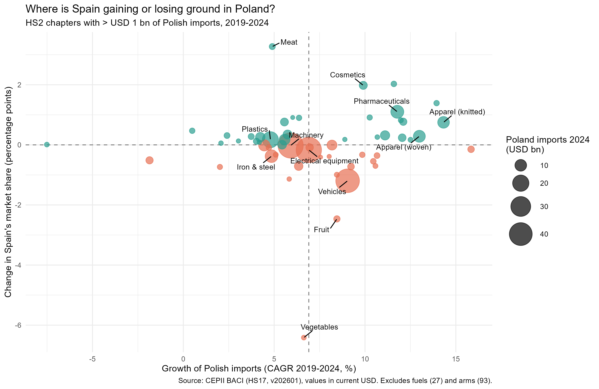
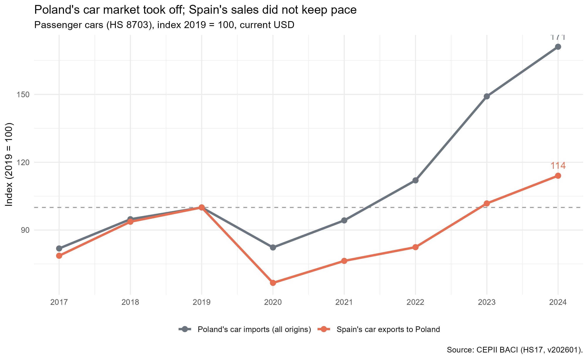

# Where Can Spanish Exporters Grow in Poland?

A market opportunity analysis of Spanish exports to Poland (2017-2024), built with R, DuckDB (SQL) and Quarto.

**[Read the full report](https://hugurry.github.io/spain-poland-export-opportunity/report/report.html)**

## Business question

In which product categories is Spain gaining or losing ground in the Polish import market, and where should Spanish exporters focus?

## Key findings

- **Spain's exports to Poland grew by 64%** between 2017 and 2024 (USD 5.9 bn to USD 9.8 bn), but **its share of Polish imports stayed flat at 2.2-2.5%**. Growth came from the market, not from gains in competitiveness.
- **Spain gains share** in pharmaceuticals, cosmetics, apparel and meat, mostly in fast-growing markets.
- **Passenger cars are the main loss.** Spain's share fell from 6.9% to 4.6% (2019-2024), worth roughly USD 0.45 bn of exports in 2024 had the 2019 share been kept. Other Western European suppliers also lost share, while Germany, Slovakia, Brazil, China and the United States gained.
- **Machinery and electrical equipment** make up almost USD 100 bn of Polish imports and Spain holds only about 1.3%.





The full analysis is in [`report/report.qmd`](report/report.qmd), rendered as `report/report.html`.

## Data

CEPII BACI, HS17 revision, version 202601 (2017-2024): bilateral trade flows at product level. Values are in current USD.
Source: http://www.cepii.fr/CEPII/en/bdd_modele/bdd_modele_item.asp?id=37

The raw files are **not included** in this repository because of their size. To reproduce the full analysis, download the HS17 version from the link above (check CEPII's terms of use) and place these files in a `data/` folder:

- `BACI_HS17_Y2017_V202601.csv` ... `BACI_HS17_Y2024_V202601.csv`
- `country_codes_V202601.csv`
- `product_codes_HS17_V202601.csv`

The summary tables created by the scripts are included in `data/processed/`, so the report can be rendered without the raw data.

## How to reproduce

1. Open `spain-poland-export-opportunity.Rproj` in RStudio.
2. Install the packages: `tidyverse`, `DBI`, `duckdb`, `ggrepel`, `knitr` and `quarto`.
3. Run the scripts in `R/` in numerical order (`01` to `08`).
4. Render `report/report.qmd`.

## Project structure

```
R/                 analysis scripts (01-08)
data/processed/    summary tables created by the scripts
output/figures/    charts used in the report
report/            Quarto report (qmd and html)
```

## Limitations

- Values are in current USD, so growth includes inflation and exchange-rate effects.
- The "value gap" (change in share x market size) is an illustration of scale, not an accounting loss.
- The analysis describes what happened, not why. For example, it does not explain the drop in car share in 2020.
- HS2 chapters are broad, and only vehicles were broken down further.
- BACI records the exporting country, not the brand or company.
- The 2024 data may be revised in later BACI releases.

## Author

Hugo Gutierrez Peralta - [GitHub](https://github.com/hugurry)